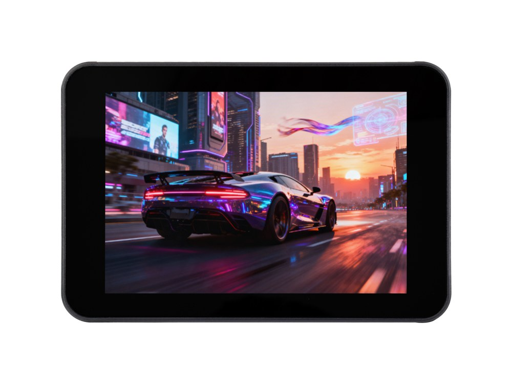

  <h1>ESP32-Touch-LCD-3.5</h1>
  
<strong>ESP32 3.5-inch 320 × 480 SPI capacitive touch LCD development board</strong>

  
<a href="README.md">English</a> | <a href="README_ZH.md">简体中文</a>

  

    
    
    
  

  

    <a href="https://www.waveshare.net/shop/ESP32-Touch-LCD-3.5.htm">🌐 Product</a> &middot;
    <a href="firmware/">📦 Firmware</a> &middot;
    <a href="examples/esp-idf/">🧩 ESP-IDF</a> &middot;
    <a href="examples/arduino/examples/">🔧 Arduino</a> &middot;
    <a href="https://www.waveshare.com/wiki/ESP32-Touch-LCD-3.5">📚 Documentation</a>
  

  

---

## ✨ Overview

This classic ESP32 development board integrates a capacitive touch LCD, audio, power management and a hardware RTC. The repository provides the current factory application suite, ESP-IDF and Arduino examples, firmware, and hardware resources.

Battery and battery-free options use the same examples. The V1.1 and V1.2 hardware revisions share the same software.

| Feature | Device / interface |
| --- | --- |
| MCU | ESP32-D0WDR2-V3, dual-core LX6, up to 240 MHz |
| Memory | 16 MB Flash, 2 MB PSRAM |
| Display | 3.5-inch IPS, 320 × 480, ST7796, SPI |
| Touch | FT6336, I2C capacitive touch |
| Audio | ES8311, microphone and speaker interface |
| Power / clock | AXP2101 / PCF85063 RTC |
| Expansion | microSD, TCA9554, USB-C serial interface, GPIO header |
| Wireless | 2.4 GHz Wi-Fi, Bluetooth 4.2 (Classic and BLE) |

## 📦 Quick Start

1. Connect the board using a USB-C data cable.
2. Download the factory merged BIN whose filename contains `FactoryOnly` from [firmware](firmware/).
3. Select **ESP32** in Flash Download Tool and flash the complete merged image at `0x0`; erase Flash before changing partition layouts.
4. Reset to open the desktop, configure Wi-Fi in Settings, then open AIChats to activate the service.

[Current factory source](examples/factory/) provides 11 applications: Settings, AIChats, Touch Test, Photos, Weather, Music, Sensor (RTC only), 2048, Mic Test, Button Test and Display Test. For Wi-Fi setup and application controls, see the [user guide](examples/factory/USER_GUIDE.md). The [legacy factory example source](examples/esp-idf/01_factory/) is retained for reference.

Example firmware packages are available from [Releases](https://github.com/waveshareteam/ESP32-Touch-LCD-3.5/releases), with flashing scripts and instructions included.

## 🧪 Examples

### ESP-IDF

| Example | Feature |
| --- | --- |
| [01_factory](examples/esp-idf/01_factory/) | Legacy factory demo: touch drawing, settings, RTC and media. |
| [02_axp2101_example](examples/esp-idf/02_axp2101_example/) | Read AXP2101 power status and handle its interrupt events. |
| [03_button_power_save](examples/esp-idf/03_button_power_save/) | Use the GPIO0 BOOT button to exercise the button and power-saving example. |
| [04_pcf85063_example](examples/esp-idf/04_pcf85063_example/) | Set and read the PCF85063 hardware RTC. |
| [05_tca9554_example](examples/esp-idf/05_tca9554_example/) | Exercise the TCA9554 I/O-expander driver through Unity tests. |
| [06_sd_card_test](examples/esp-idf/06_sd_card_test/) | Mount a microSD card over SPI and read/write a test file. |
| [07_lvgl_example](examples/esp-idf/07_lvgl_example/) | Display LVGL widgets with capacitive touch input. |
| [08_lvgl_audio_play](examples/esp-idf/08_lvgl_audio_play/) | Play microSD audio through ES8311 using the LVGL music interface. |
| [09_lvgl_image](examples/esp-idf/09_lvgl_image/) | Display the embedded image with LVGL and touch support. |

### Arduino

| Example | Feature |
| --- | --- |
| [01_i2s_audio](examples/arduino/examples/01_i2s_audio/) | Play /music/1.mp3 from microSD using the ES8311 codec. |
| [02_axp2101_example](examples/arduino/examples/02_axp2101_example/) | Inspect AXP2101 power and battery status. |
| [03_button_example](examples/arduino/examples/03_button_example/) | Report BOOT and PWR button clicks, double-clicks and long presses. |
| [04_es8311_example](examples/arduino/examples/04_es8311_example/) | Exercise ES8311 I2S audio recording and playback. |
| [05_pcf85063_example](examples/arduino/examples/05_pcf85063_example/) | Set and read the PCF85063 calendar and demonstrate Unix-time conversion. |
| [06_tca9554_example](examples/arduino/examples/06_tca9554_example/) | Exercise the TCA9554 I/O-expander outputs. |
| [07_sd_card_test](examples/arduino/examples/07_sd_card_test/) | List, create, read and write files on the microSD card. |
| [08_gfx_helloworld](examples/arduino/examples/08_gfx_helloworld/) | Draw text and graphics with Arduino_GFX. |
| [09_lvgl_basic](examples/arduino/examples/09_lvgl_basic/) | Display a basic LVGL 9 interface with touch switches. |
| [10_lvgl_arduino_v9](examples/arduino/examples/10_lvgl_arduino_v9/) | Demonstrate LVGL 9 display buffers and capacitive touch. |
| [11_bt_music_receiver_arduino_i2s](examples/arduino/examples/11_bt_music_receiver_arduino_i2s/) | Receive Bluetooth Classic A2DP audio and show track metadata. |

Shared libraries: [examples/arduino/libraries](examples/arduino/libraries/).

## 🛠️ Development Environment

| Framework | Version | Examples |
| --- | --- | ---: |
| ESP-IDF | v5.5.6, v6.1 | 9 |
| Arduino-ESP32 | 3.3.12 | 11 |
| Current factory project | ESP-IDF v5.5.4, LVGL 9.6.0~1 | 1 |

Versions and Arduino board options are defined in [product.json](.github/product.json). Arduino examples share the bundled LVGL 9 library; copy the supplied libraries and shared `lv_conf.h` into your sketchbook `libraries` directory.

## 📚 Resources

- [V1.1 schematic](hardware/schematic/ESP32-Touch-LCD-3.5-Schematic-V1.1.pdf)
- [V1.2 schematic](hardware/schematic/ESP32-Touch-LCD-3.5-Schematic-V1.2.pdf)
- [Product page](https://www.waveshare.net/shop/ESP32-Touch-LCD-3.5.htm)
- [Wiki](https://www.waveshare.com/wiki/ESP32-Touch-LCD-3.5)

## 🤝 Support

- Repository problems: [GitHub issues](https://github.com/waveshareteam/ESP32-Touch-LCD-3.5/issues).
- Product and hardware questions: [Waveshare support](https://service.waveshare.com/).

## 📄 License

First-party code is provided under [Apache-2.0](LICENSE). Third-party components retain their original licenses and attribution.

